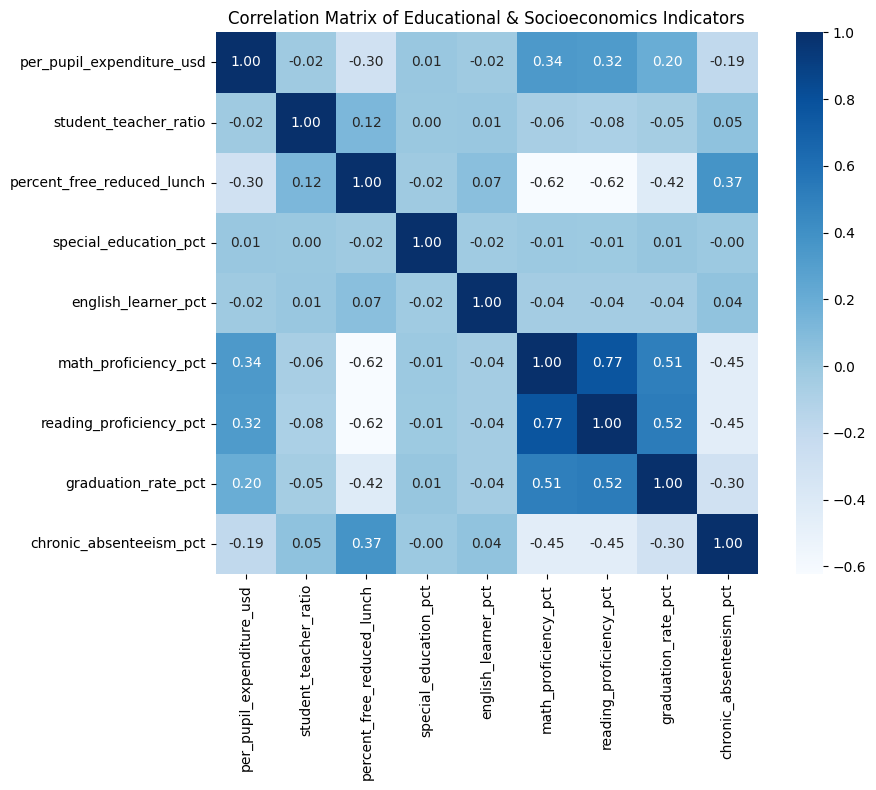

# 🎓 Student Portfolio Submission — Emmanuel Bright Chetachi

[](https://github.com/Ecoplex82)
[](https://github.com/Ecoplex82)
[]()
[]()
[]()

> **Applied Machine Learning Pipelines, Diagnostic Model Auditing, Business-Valued Visualizations, and Executive Strategy Portfolio.**

---

> [!IMPORTANT]
> ### ⚠️ Mandatory Educational Disclaimer & Caveat
> **The dataset and statistical analyses in this submission are compiled strictly for educational, pedagogical, and coursework purposes within the AltSchool Africa Data Science & Machine Learning track.**  
> **Caveat**: The data used here is **NOT a reflection of the actual United States educational system**, the National Center for Education Statistics (NCES), or any specific academic institution. All records, metrics, and relationships are simulated/synthetic, designed solely for training and evaluating machine learning workflows. Any resemblance to real institutions, living persons, or actual government records is purely coincidental.

---

## 📌 Submission Metadata

| Attribute | Details |
| :--- | :--- |
| **Student Name** | Emmanuel Bright Chetachi |
| **GitHub Handle** | [`@Ecoplex82`](https://github.com/Ecoplex82) |
| **Cohort** | Baraka 2026 — AltSchool Africa Data Science Track |
| **Sessions Covered** | Live Sessions 1–4 (ML Visualization, Diagnostic Modeling, Dimensionality Reduction & Business Value Case Study) |
| **Submission Directory** | `submissions/emmanuel-bright/` |
| **Root Dataset Reference** | `../../us_education_system_dataset.csv` (5,000 records, 35 attributes) |
| **Root Codebook Reference** | [`../../us_education_system_data_dictionary.md`](../../us_education_system_data_dictionary.md) |

---

## 📂 Submission Deliverables

```text
submissions/emmanuel-bright/
├── README.md                                           # Executive portfolio & submission documentation
├── session_01_ml_visualization.ipynb                   # Session 1: ML Visualization & Univariate/Multivariate EDA
├── session_02_correlation_and_model_diagnostics.ipynb  # Session 2: Correlation Matrix, Random Forest & 2D PCA
├── session_03_business_value_of_ml_visualization.ipynb # Sessions 3 & 4: Business Value & $50M Allocation Case Study
└── images/                                             # Visual assets, charts, and diagnostic plots
    ├── Resource Allocation.png
    ├── Business Lever Analysis.png
    ├── Business Lever Analysis - Title Staus.png
    ├── corr_matrix.png
    ├── corr_matrix_features.png
    ├── Confusion Matrix.png
    └── 2D PCA Projection.png
```

---

## 🔬 In-Depth Session Highlights & Analytical Takeaways

### 📍 Session 1: ML Visualization & Exploratory Data Analysis (EDA)
* **Notebook:** [`session_01_ml_visualization.ipynb`](session_01_ml_visualization.ipynb)
* **Core Takeaways:**
  * Configured publication-quality visualization pipelines using `matplotlib` and `seaborn`.
  * Evaluated per-pupil expenditures (`per_pupil_expenditure_usd`) using Kernel Density Estimation (KDE) and histograms to identify skewness and funding variance across school counts.
  * Assessed math proficiency splits across federal Title I designations (`title_i_status`) using stratified box plots.
  * Formulated multi-variable scatter plots mapping student socioeconomic needs (`percent_free_reduced_lunch`) against academic output (`math_proficiency_pct`), hue-encoded by governance (`control`: Public, Charter, Private) and scaled by per-pupil spending.


---

### 📍 Session 2: Statistical Correlation, Supervised Diagnostics & PCA
* **Notebook:** [`session_02_correlation_and_model_diagnostics.ipynb`](session_02_correlation_and_model_diagnostics.ipynb)
* **Core Takeaways:**
  * **Intercorrelation & Heatmap Analysis:** Formatted continuous numeric indicators across 9 key features, computed Pearson correlation coefficients, and rendered annotated heatmaps to inspect collinearity and primary academic drivers.
  * **Supervised Machine Learning Diagnostic:** 
    * Established a binary target $y \in \{0, 1\}$ classifying achievement tiers based on the median math proficiency benchmark ($y = 1$ if $\text{math\_proficiency\_pct} \ge \text{median}$, else $0$).
    * Trained a baseline `RandomForestClassifier(n_estimators=100, random_state=42)` on a 70/30 train-test split.
    * Evaluated model performance using diagnostic confusion matrix heatmaps to inspect Type I and Type II errors in simple operational terms.
  * **Unsupervised Learning & Dimensionality Reduction:** Standardized feature dimensions with `StandardScaler` and applied `PCA(n_components=2)` to project multidimensional institutional profiles onto 2 orthogonal axes.

| Correlation Matrix | Confusion Matrix Diagnostic | 2D PCA Projection |
| :---: | :---: | :---: |
|  |  |  |

---

### 📍 Sessions 3 & 4: Business Value of Data Visualization for Machine Learning
* **Notebook:** [`session_03_business_value_of_ml_visualization.ipynb`](session_03_business_value_of_ml_visualization.ipynb)
* **Core Takeaways:**
  * **"Why Business Leaders Don't Buy Black Boxes":** 95% test accuracy alone fails to convince executive stakeholders if models lack interpretability, auditability, and clear business levers. Data visualization serves as the critical translation layer across the ML lifecycle.
  * **Real-World Case Study ($50M Intervention Fund):** Advised a state Department of Education tasked with strategically deploying a $50M capital fund to improve student math proficiency.
  * **Resource Allocation Audit:** Analyzed spending distributions to identify financial skewness and benchmarked academic outcomes across federal Title I funding tiers.
  * **Discovering Business Levers & ROI:** Investigated whether capital expenditure alone resolves performance gaps or if socioeconomic factors are stronger drivers. Visualizations revealed that without addressing underlying socioeconomic hardship (`percent_free_reduced_lunch`), financial investments yield diminishing returns.
  * **Feature Redundancy Elimination:** Identified collinear predictors using diverging `coolwarm` correlation heatmaps to build lean, parsimonious, and reliable models.

| Business Lever Analysis (Governance) | Business Lever Analysis (Title I Status) |
| :---: | :---: |
|  |  |

---

## 🛠️ Reproducibility & Execution Standards

- **Portable Relative Data Paths:** Notebooks reference the shared root dataset dynamically via `../../us_education_system_dataset.csv` with fallback support for standalone environments or Google Colab.
- **Zero Machine-Specific Paths:** All machine-specific paths (`C:\Users\...`) have been completely eliminated.
- **Root Isolation:** Zero modifications have been made to shared root configuration files (`README.md`, `requirements.txt`, root notebooks, or `.gitignore`).
- **Dependencies:** Fully compatible with root [`../../requirements.txt`](../../requirements.txt).
